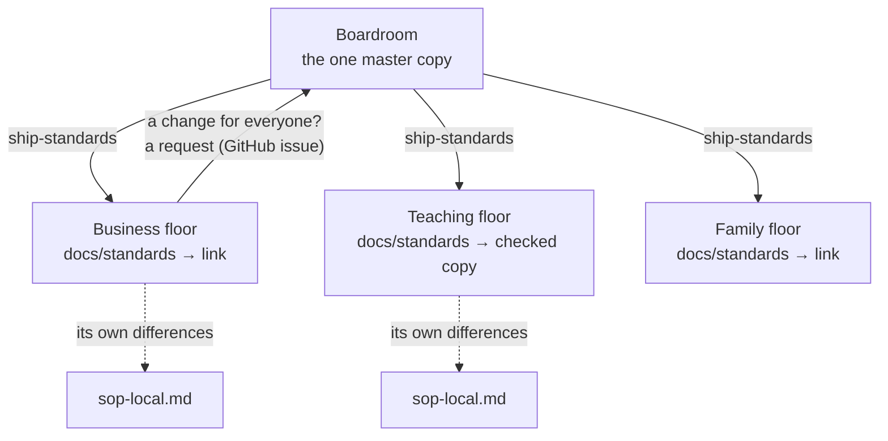

# Marshall Inc Standards

The ten standards that run Marshall Inc: one Mac, a "floor" for each part of my life, and Claude Code sessions doing the work on every floor. Every session reads these before it does anything.

They're shared here as they're actually used, with real names, paths and accounts swapped for generic ones. They are long and specific on purpose. Each one was written because something broke.

Dr. Bryan Marshall · [YouTube](https://www.youtube.com/@drbryanmarshall) · [bryanmarshall.com](https://bryanmarshall.com)

## The pattern behind every standard

1. **Something breaks**, and I notice.
2. **I write the rule down**, in a file every session reads.
3. **A script checks it**, so nobody has to remember it.

## The ten

| # | Standard | What broke | What it does for the whole company |
|---|---|---|---|
| 1 | [The SOP](standards/sop.md) | Every session did a task its own way, so nothing matched. | One path for every task, from an issue to a check, so any session can pick up any task. |
| 2 | [Organization](standards/organization-standard.md) | Jobs overlapped, and nobody could say who owned what. | One job per room, and a fixed direction for things to flow. Every job has one owner. |
| 3 | [GitHub](standards/github-standard.md) | One session committed another session's half-finished work. | Each session ships only the files it touched; every change starts as an issue in a milestone. |
| 4 | [The brain](standards/brain-standard.md) | Notes were scattered, and received documents ended up in git. | What you wrote is a markdown note; what you received is a document with a small JSON summary beside it. One place to look. |
| 5 | [Skills (DOE)](standards/doe-framework.md) | Small errors multiply: 90% right per step is 59% after five steps. | The model plans and plain scripts do the counting, so a skill gives the same answer every time. |
| 6 | [The hall](standards/hall-standard.md) | Every floor was set up a little differently. | Every floor has the same parts, and a script checks each one; a check that couldn't run is never a pass. |
| 7 | [Communication](standards/communication-standard.md) | Things were filed by topic, not by owner, and landed on the wrong floor. | Route by one fact, whose it is. Nothing gets lost, and the top of each inbox is what's still open. |
| 8 | [Security](standards/security-standard.md) | A backup script once copied a live server key into a cloud folder. | Every secret lives in a vault, one per floor, and each floor can open only its own. |
| 9 | [Deploys](standards/deploy-standard.md) | Shipping failed nine different ways, most of them blaming the wrong thing. | Every trap is written down, no secrets ship, and a deploy is done when the live site says it's healthy. |
| 10 | [The software factory](standards/software-factory.md) | A builder that can edit its own test can always pass. | The proof lives where the builder can't touch it, and the whole thing is tested once at the end. |

Start with the [SOP](standards/sop.md). It is the front page and points to the other nine.

## Use them in your own project

It takes about five minutes, and Claude does most of it.

**Want a ready-made building instead?** [marshall-inc-starter](https://github.com/bamarshall06/marshall-inc-starter) is a template repo with these standards already in place, an HQ contract, three example floors and four small scripts. Click **Use this template** and follow its `GETTING-STARTED.md`.

1. **Copy the standards in.** Download this repo (green **Code** button → **Download ZIP**, or `git clone`), and copy the `standards` folder into your project as `docs/standards/`.
2. **Point Claude at them.** Copy [`starter/CLAUDE.md`](starter/CLAUDE.md) to the root of your project and fill in the first section. Claude Code reads `CLAUDE.md` at the start of every session, and it tells Claude to start with `docs/standards/sop.md`.
3. **Write your differences down, don't edit the standards.** Copy [`starter/sop-local.md`](starter/sop-local.md) to `docs/sop-local.md`. Anything your project does differently goes there, one section per change, with the reason. That file wins for your project.
4. **Let Claude fit them to you.** The standards describe one person's setup, so ask Claude to adapt them:

> Read docs/standards/ and my CLAUDE.md. I run [describe your setup: a class, a team, a small business]. Tell me which rules fit as they are, which ones I should change in docs/sop-local.md, and which I can ignore, with one sentence of why for each. Don't change anything until I say so.

That's it. From then on, every Claude Code session in that project reads the same rules.

**A student version:** a group project needs only one rule to start, like *nobody changes the final file without a review*. Put it in `CLAUDE.md`, and ask Claude to check it before every commit.

## How I roll them out to every floor

Marshall Inc has a floor for each part of my life, and every floor follows the same ten standards. Here's how one set of rules reaches all of them without drifting apart.

- **One master copy.** The standards live in exactly one place, the Boardroom (my general manager). Only the Boardroom writes a standard, and the Security floor writes the security standard.
- **Pushed down, not copied around.** A script (`ship-standards`) gives every floor a link to the master copy, so a change made once reaches every floor at once. A floor that can't follow a link (one whose repo travels to a laptop) gets a copy instead, verified by checksum.
- **A notice tells everyone.** When a standard changes, it changes once, in the Boardroom. The Boardroom then sends a notice to every floor saying the standards were updated. Each floor reads the change, adjusts how it works to match, and archives the notice; a notice still sitting at the top of a floor's messages is work that floor hasn't done yet.
- **Never edited on a floor.** A guard script refuses an edit made through a link, and the next push overwrites a copy anyway.
- **Differences go in `sop-local.md`.** A floor that works differently writes the change and the reason in its own `sop-local.md`. It wins for that floor, except over the hard restrictions.
- **The hard rules live in every `CLAUDE.md` too.** An agent that has to follow a link to learn a rule will sometimes not follow it, so the rules that must never break are repeated in each floor's contract.
- **Changes go up as requests.** If a floor needs a rule changed for everyone, it files a request (a GitHub issue) to the Boardroom, saying what the standard says, what's actually true, and how that was checked.
- **A script checks every floor.** `district-ready` confirms each floor's standards are linked or current, that no link is broken, and that its `sop-local.md` is real, not the blank template.

You don't need any of this for one project. It starts to matter at two or three: keep one master copy and link to it, rather than letting copies drift.

## Words you'll see

| Word | Meaning |
|---|---|
| Hall, district, floor | One part of my life, with its own volume, repos, notes and password vault (Business, Teaching, Money, Family…). |
| Boardroom, GM | The general manager: it writes these standards and takes in anything new. |
| Computer Room | Builds the Marshall Inc app every session starts from. |
| Security | Owns every secret, server key and backup. |
| Worker, District Manager | Claude Code sessions: a manager plans the work, workers each take one issue. |
| Brain | A folder of markdown notes in its own git repo, plus a search index. |
| `bin/ship`, `district-ready`… | Scripts that do the checking. They aren't in this repo; the standards say what they must do. |

## The videos

- [Two Macs, One Desk: How I Fix Problems with Claude](https://youtu.be/rf93txZfUx0): the machine, and the find it / plan it / build it process.
- [How I Build Marshall Inc](https://youtu.be/7U8FYGVo6c8): a floor for each part of life, in three steps.
- [The 10 Rules That Run My AI Company](https://youtu.be/dEqfeqZxSZA): the why behind each of these documents.
- New to Claude Code? Start with the [Start Here playlist](https://www.youtube.com/playlist?list=PLHdusAKY4gWk).

The skill standard is built on Nick Saraev's DOE framework (Directive, Orchestration, Execution); my video on it is [here](https://youtu.be/FzUFVcOuE9o).
